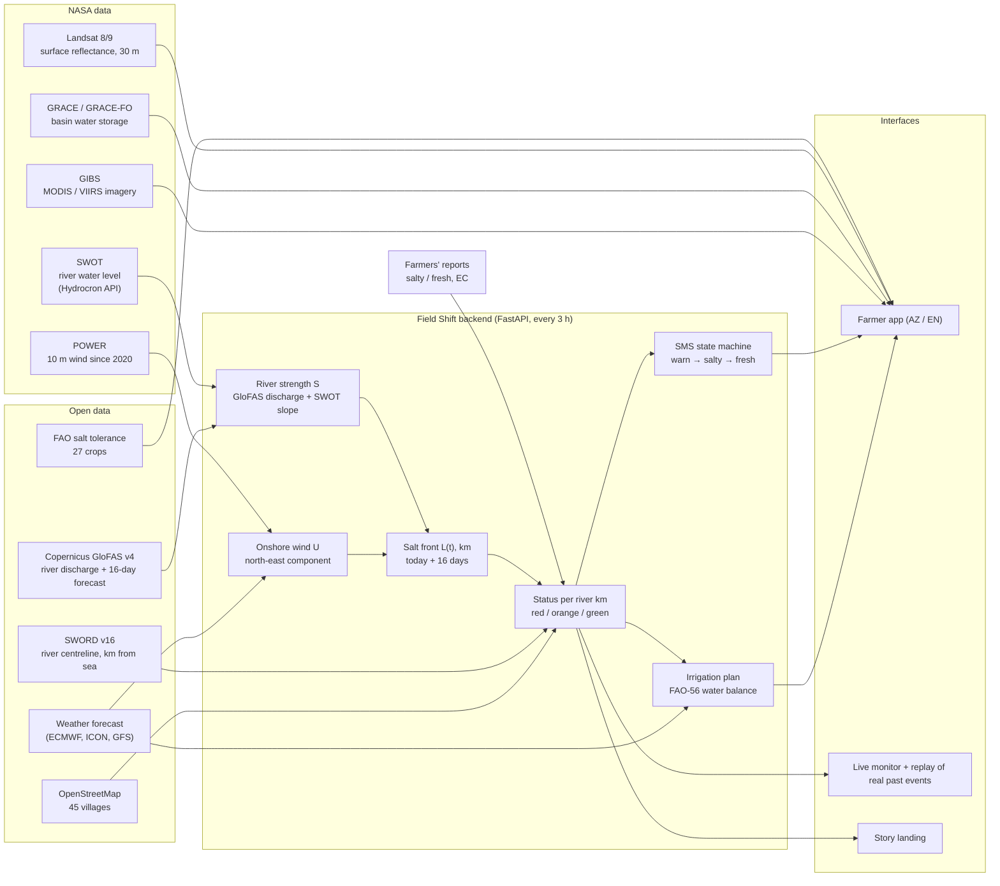

# Field Shift: Kür salt-water intrusion forecast

**NASA Space Apps Challenge 2026 · Team Earthly**

Field Shift forecasts, every day, how far salty Caspian Sea water has pushed up the lower Kür river (Azerbaijan),
and turns that distance into a status for every pump, field and village along the last 160 km of the river.
It runs on NASA satellite and reanalysis data (SWOT, POWER, GRACE/GRACE-FO, Landsat), with open river-discharge
forecasts from Copernicus GloFAS. It is live, refreshed every 3 hours, with a 16-day outlook.

Live: <https://fieldshift.olimpedia.site> · Monitor: <https://fieldshift.olimpedia.site/monitor> · Farmer app: <https://fieldshift.olimpedia.site/app>

---

## Contents

1. [The physical problem](#1-the-physical-problem)
2. [System overview](#2-system-overview)
3. [Data sources](#3-data-sources)
4. [Verify every data source yourself](#4-verify-every-data-source-yourself)
5. [The salt-front model](#5-the-salt-front-model)
6. [From distance to status](#6-from-distance-to-status)
7. [Ground observations and data fusion](#7-ground-observations-and-data-fusion)
8. [Alerts](#8-alerts)
9. [Irrigation plan (FAO-56 water balance)](#9-irrigation-plan-fao-56-water-balance)
10. [Soil salinity trend (Landsat)](#10-soil-salinity-trend-landsat)
11. [Basin water loss (GRACE)](#11-basin-water-loss-grace)
12. [Back-test 2020–2026](#12-back-test-20202026)
13. [Replay of past events](#13-replay-of-past-events)
14. [Build, run, deploy](#14-build-run-deploy)
15. [Credits and licences](#15-credits-and-licences)

---

## 1. The physical problem

At a river mouth, fresh river water flows out over denser sea water. Caspian water carries 12–13 g/l of salt
(about 20 dS/m), so it is roughly 1 % denser than the Kür. When the river is strong it holds the sea back at the mouth.
When river discharge drops, and a north-easterly wind piles Caspian water against the Kür delta, the heavier salt water
creeps upstream along the river bed as a **salt wedge**. The surface can stay fresh while an intake near the bed draws
brackish water.

The lower Kür has weakened over recent dry years. Azerbaijan reports a decline of more than 25 % in water resources
over the last four years, and NASA GRACE shows the Kür–Araz basin losing 22.5 cm of water-equivalent storage in
2002–2022 (section 11). Intrusion has been measured at about 66 km (August 2020) and reported at about 30 km (March 2022); see section 1.1.

Irrigation water above 3 dS/m causes severe yield restriction (FAO, Ayers & Westcot 1985). Caspian water is about
seven times that threshold.

### 1.1 Evidence: this is happening now

Every link of the chain below is measured or officially reported, and the model in this repository reproduces the
mechanism. Sources are numbered and listed at the end of this section.

| # | What | Evidence | Source |
|---|---|---|---|
| 1 | **There is less water** | Azerbaijan's water resources fell by **more than 25 %** over four dry years. | [Trend.az](https://www.trend.az/business/4013754.html) |
| 2 | **The whole basin is drying, seen from space** | NASA GRACE / GRACE-FO: the Kür–Araz basin lost **22.5 cm** of water-equivalent storage in 2002–2022 (−1.48 cm per year). | [NASA GRACE data (grace.json)](data/kur/grace.json), [section 11](#11-basin-water-loss-grace) |
| 3 | **The mechanism is officially confirmed** | Ministry of Ecology and Natural Resources: when the Kür level and flow drop and the **north-east wind** strengthens, Caspian water enters the channel; it advanced about **30 km**, first to **Xıllı**, then to **Surra**. These are exactly the two inputs of our model (river strength and onshore NE wind). | [Ministry of Ecology (RFE/RL)](https://www.azadliq.org/a/k%C3%BCr-quruyur-yoxsa-qurudulur/30702960.html) |
| 4 | **Intrusion was measured in the river** | EU Water Initiative Plus survey (August 2020, 23 sampling points, at the request of the Ministry): Caspian water (salinity ≈ 16) entered the Kura for **about 66 km**; salinity **10.6** across the delta. Cause given: upstream abstraction for agriculture cutting downstream flow, plus wind and waves. | [EU Water Initiative+](https://euwipluseast.eu/en/component/content/article/156-all-activities/activites-azerbaijan/news-of-azerbaijan/810-intrusion-of-seawater-beyond-the-kura-river-delta-in-azerbaijan-euwi-survey-to-identify-the-scale-of-water-quality-changes?Itemid=397) |
| 5 | **River chemistry shows sea water at Neftçala** | "Azərsu" Central Laboratory monitoring, 2020–2022, 13 points along the Kura: mineralization at **Neftçala above 3,000 mg/l**, **8.8 times** the upstream value (348.7 mg/l at I Şıxlı); chloride **1,238 mg/l** at Neftçala vs 11.8 mg/l upstream; sulphate **1,013 mg/l at Xıllı**. The authors attribute the rise partly to the mixing of Caspian water with Kür water in the Neftçala district. | [Discover Water 2025](https://doi.org/10.1007/s43832-025-00219-9) |
| 6 | **Sea-water tracers confirm it** | Samples near Neftçala, 2020–2022: **strontium ×4.8** and **boron ×7.5** compared with the Şıxlı-1 station, while silicon halves. | [Kura Si/Sr/B study](https://doi.org/10.3103/S106837392602010X) |
| 7 | **It keeps coming back** | March 2022: a branch of the Kür dried up and Caspian water flowed into the river (press). Our model gives **29.6 km** for those days. | [Bayraqdar, 9 Mar 2022](https://www.bayraqdar.info/2022/03/09/kur-cayinin-bir-qolu-quruyub-x%C9%99z%C9%99rin-suyu-kur%C9%99-axir/), [section 12.2](#122-documented-event) |
| 8 | **Satellites see the river losing its push** | NASA SWOT, 10 March 2024: the water-surface drop from km 51 to km 13 was only **0.26 m** (median 1.7 m). The river was almost flat, and the model places the salt front beyond **50 km**. | [NASA SWOT Hydrocron](https://soto.podaac.earthdatacloud.nasa.gov/hydrocron/v1/timeseries?feature=Reach&feature_id=28461000013&start_time=2024-03-01T00:00:00Z&end_time=2024-03-15T00:00:00Z&output=csv&fields=reach_id,time_str,wse,reach_q), [section 12.3](#123-swot-observations) |
| 9 | **The water is unusable for irrigation** | FAO irrigation-water guidelines: above **3 dS/m** severe restriction; chloride above **10 meq/l** severe toxicity for surface irrigation. The 2020–2022 Neftçala averages (3,000 mg/l ≈ **4.7 dS/m**; 1,238 mg/l chloride ≈ **35 meq/l**) are above both limits. | [FAO Paper 29](https://www.fao.org/4/t0234e/t0234e00.htm), [Discover Water 2025](https://doi.org/10.1007/s43832-025-00219-9) |
| 10 | **Soil shows it** | Landsat 8/9 (30 m), bare post-harvest land around 45 villages: the surface-salt index of the delta zone rose **5 %** (median) and **12 %** (90th percentile) from 2021 to 2023. | [Landsat data (soil.json)](data/kur/soil.json), [section 10](#10-soil-salinity-trend-landsat) |
| 11 | **People are affected** | Water shortage in the lower Kür–Araz districts has led to public protests. | [Eurasianet](https://eurasianet.org/police-crack-down-on-water-protest-in-azerbaijan) |**Chain:** less water (1, 2) → weaker Kür + north-east wind (3) → sea water measured tens of kilometres up the river
(4, 5, 6, 7, 8) → river water above FAO irrigation limits (9) → salt in the soil and hardship in the villages (10, 11).
Field Shift turns the two drivers into a daily, per-pump warning.

**Sources**

1. Trend.az, "Azerbaijan faces notable decline in water resources – official": <https://www.trend.az/business/4013754.html>;
   bne IntelliNews, "Azerbaijan faces growing water shortage": <https://www.intellinews.com/azerbaijan-faces-growing-water-shortage-190261/>
2. This repository: `data/kur/grace.json` (NASA GRACE / GRACE-FO JPL mascons via NASA GIBS), `data/kur/soil.json`
   (Landsat 8/9 Collection 2 Level-2). Build scripts: `backend/etl/kur_grace.py`, `backend/etl/kur_soil.py`.
3. RFE/RL Azadliq, "Kür quruyur, yoxsa 'qurudulur'" (statement of the Ministry of Ecology and Natural Resources):
   <https://www.azadliq.org/a/k%C3%BCr-quruyur-yoxsa-qurudulur/30702960.html>
4. EUWI+ (European Union Water Initiative Plus for the Eastern Partnership), "Intrusion of seawater beyond the Kura river
   delta in Azerbaijan": <https://euwipluseast.eu/en/component/content/article/156-all-activities/activites-azerbaijan/news-of-azerbaijan/810-intrusion-of-seawater-beyond-the-kura-river-delta-in-azerbaijan-euwi-survey-to-identify-the-scale-of-water-quality-changes?Itemid=397>;
   technical report: <https://www.researchgate.net/publication/386293275>
5. Aliyev E., Abduyev M. (2025), "Quality trend of Kura River in Azerbaijan by major ion concentration",
   *Discover Water* 5:82, <https://doi.org/10.1007/s43832-025-00219-9>
6. "Analysis of the Variability of Silicon, Strontium, and Boron Content in the Kura River (on the Territory of the
   Republic of Azerbaijan)", <https://doi.org/10.3103/S106837392602010X>
7. Bayraqdar Media, 9 March 2022, "Kür çayının bir qolu quruyub, Xəzərin suyu Kürə axır":
   <https://www.bayraqdar.info/2022/03/09/kur-cayinin-bir-qolu-quruyub-x%C9%99z%C9%99rin-suyu-kur%C9%99-axir/>
8. NASA SWOT, PO.DAAC Hydrocron API (reaches 28461000013 and 28461000051); this repository: `data/kur/history.json`.
9. Ayers R.S., Westcot D.W. (1985), *Water quality for agriculture*, FAO Irrigation and Drainage Paper 29 Rev. 1,
   Table 1: <https://www.fao.org/4/t0234e/t0234e00.htm>
10. Eurasianet, "Police crack down on water protest in Azerbaijan": <https://eurasianet.org/police-crack-down-on-water-protest-in-azerbaijan>

## 2. System overview



| Layer | Technology | Role |
|---|---|---|
| Model and API | Python 3, FastAPI, SQLite (WAL) | `backend/app/kur.py` recomputes the state every 3 hours, caches it in memory and in `data/kur/state.json`, and keeps serving the last good state if an upstream API fails |
| Data pipelines | Python (`backend/etl/kur_*.py`) | Build the static layers (river, villages, soil, GRACE) and the 2020–2026 back-test |
| Interfaces | React (Vite), Leaflet | Landing (`/`), farmer app (`/app`), monitor (`/monitor`); Azerbaijani and English |

## 3. Data sources

| Source | Provider | What we take | Resolution / revisit | Access | Licence |
|---|---|---|---|---|---|
| **SWOT** L2 river single-pass (Hydrocron) | NASA / CNES | Water-surface elevation (`wse`) of 8 SWORD reaches of the lower Kür, with quality flag `reach_q` | Reach ≈ 10 km · 21-day repeat orbit | `soto.podaac.earthdatacloud.nasa.gov/hydrocron/v1/timeseries`, no login | NASA open data |
| **SWORD v16** | SWOT science team | River centreline, reach IDs, distance from the sea (km), width | Reach ≈ 10 km | Public PMTiles (SWORD Explorer) | CC BY 4.0 |
| **NASA POWER** (MERRA-2, AG community) | NASA LaRC | Daily 10 m wind speed and direction (`WS10M`, `WS10M_MAX`, `WD10M`) over the Kür delta, 2020 → today | 0.5° × 0.625° · daily | `power.larc.nasa.gov/api/temporal/daily/point` | NASA open data |
| **GRACE / GRACE-FO** JPL mascons | NASA JPL | Liquid-water-equivalent thickness anomaly over the Kür–Araz basin box | ~3° mascons · monthly · 2002–2022 on GIBS | NASA GIBS WMS, decoded through the published colour map | NASA open data |
| **Landsat 8/9** Collection 2 Level-2 | NASA / USGS | Surface reflectance (blue, red, NIR) for a salinity index, 2021–2025 | 30 m · 16 days (8 days with both) | Microsoft Planetary Computer STAC (mirror of USGS data) | Public domain |
| **NASA GIBS** basemap and imagery | NASA EOSDIS | VIIRS / MODIS true colour, labels for the map | 250 m–1 km | WMTS | NASA open data |
| **GloFAS v4** | Copernicus EMS (ECMWF) | Daily river discharge at the Kür mouth (39.275 N, 49.275 E), the Kür above the Araz confluence and the Araz, reanalysis 2020 → today and 16-day forecast | 0.05° · daily | Open-Meteo flood API | CC BY 4.0 |
| Weather forecast | Open-Meteo (ECMWF, DWD ICON, NOAA GFS) | Hourly 10 m wind for the next 16 days; daily rain and FAO-56 ET0 | 1–11 km · hourly | `api.open-meteo.com` | CC BY 4.0 |
| OpenStreetMap | OSM contributors | 45 settlements within 4 km of the river below the Araz confluence | Point | Overpass API | ODbL |
| Crop salt tolerance | FAO (Ayers & Westcot 1985) | Soil ECe at which yield starts to fall, 27 crops | Table | Publication | Free with citation |

Every source, its licence and a link are also listed in the app (`/data`) and served by `GET /api/meta`.

## 4. Verify every data source yourself

Each request below is the one the code makes (same endpoint, same parameters), narrowed to a few days so it returns
instantly. All of them are public and need no account. They were run successfully on 15 November 2026.

**NASA SWOT: the river level on 10 March 2024** (reach at km 13 from the sea)

```bash
curl "https://soto.podaac.earthdatacloud.nasa.gov/hydrocron/v1/timeseries?feature=Reach&feature_id=28461000013&start_time=2024-03-01T00:00:00Z&end_time=2024-03-15T00:00:00Z&output=csv&fields=reach_id,time_str,wse,reach_q"
# → 28461000013, 2024-03-10T01:48:27Z, wse = -27.92 m, reach_q = 1
```

Run it again with `feature_id=28461000051` (km 51): the difference between the two is the river slope used by the model.

**NASA POWER: the wind during the March 2022 event** (Kür delta)

```bash
curl "https://power.larc.nasa.gov/api/temporal/daily/point?parameters=WS10M,WD10M&community=AG&latitude=39.35&longitude=49.40&start=20220308&end=20220311&format=CSV"
```

**Copernicus GloFAS: river discharge at the Kür mouth in the same days**

```bash
curl "https://flood-api.open-meteo.com/v1/flood?latitude=39.275&longitude=49.275&daily=river_discharge&start_date=2022-03-08&end_date=2022-03-11"
# → 225.99, 223.39, 219.29, 216.77 m³/s  (median 2020–2026: 334 m³/s)
```

**NASA GRACE / GRACE-FO: the basin water storage map** (open in a browser, June 2022)

<https://gibs.earthdata.nasa.gov/wms/epsg4326/best/wms.cgi?SERVICE=WMS&VERSION=1.3.0&REQUEST=GetMap&LAYERS=GRACE_Tellus_Liquid_Water_Equivalent_Thickness_Mascon_CRI&CRS=EPSG:4326&BBOX=38.4,43.5,42.3,49.0&WIDTH=390&HEIGHT=234&FORMAT=image/png&TIME=2022-06-01>

**Landsat 8/9: the scenes used for the soil index** (cloud cover below 10 %, post-harvest 2024)

```bash
curl -X POST "https://planetarycomputer.microsoft.com/api/stac/v1/search" -H "Content-Type: application/json" \
  -d '{"collections":["landsat-c2-l2"],"bbox":[48.85,39.2,49.45,40.0],"datetime":"2024-08-15/2024-10-31","query":{"eo:cloud_cover":{"lt":10}},"limit":5}'
```

**SWORD river database:** browse the Kür reaches (IDs `28461000013` … `28461000121`) at <https://www.swordexplorer.com/>.

**OpenStreetMap villages:** e.g. Xıllı, used in the alerts and named by the Ministry of Ecology:

```bash
curl -A "verify" "https://nominatim.openstreetmap.org/search?q=X%C4%B1ll%C4%B1%2C+Neft%C3%A7ala&format=json&limit=1"
```

**NASA imagery used on the landing:** MODIS Terra true colour, Kür delta, 3 September 2025, in NASA Worldview:
<https://worldview.earthdata.nasa.gov/?v=48.2,38.9,50.0,40.2&l=MODIS_Terra_CorrectedReflectance_TrueColor&t=2025-09-03>

**The model's own numbers** come from the live API of the app:

| What | Endpoint |
|---|---|
| Today's inputs, salt front and 16-day forecast | <https://fieldshift.olimpedia.site/api/kur/state> |
| The 2020–2026 back-test, day by day | <https://fieldshift.olimpedia.site/api/kur/daily> |
| A real past episode re-run (10 March 2022) | <https://fieldshift.olimpedia.site/api/kur/replay?day=2022-03-04&n=10> |
| GRACE series and trend | <https://fieldshift.olimpedia.site/api/kur/grace> |
| All sources and licences | <https://fieldshift.olimpedia.site/api/meta> |

## 5. The salt-front model

The model is deliberately small and fully transparent. Every coefficient is shown in the API output (`state.model`).

### 5.1 River strength

```
S_Q    = max(Q, 50) / Q_ref                    Q     = GloFAS discharge at the mouth (m³/s)
                                               Q_ref = 334 m³/s, median 2020–2026
S_head = max(H, 0.05) / H_ref                  H     = SWOT water-surface slope, km 13.4 → km 51.4 (m)
                                               H_ref = 1.7 m, median of SWOT passes
S      = 0.5 · S_Q + 0.5 · S_head              when a SWOT pass exists within the last 12 days
S      = S_Q                                   otherwise
S      = max(S, 0.15)
```

GloFAS gives a daily, forecastable discharge but is a model. SWOT gives a direct physical measurement of the
river's push against the sea (the water-surface drop from km 51 to km 13), but only every ~21 days. Blending the two
anchors the modelled discharge to an observation whenever one exists.

### 5.2 Onshore wind

```
U = max(0, ws · cos(wd − 45°))                 ws, wd = hourly 10 m wind speed (m/s) and direction (°)
                                               daily U = mean of the hourly values (≥ 12 hours required)
```

Only the component blowing from the north-east (45°) counts. Winds from that sector drive Caspian water south along
the western coast and raise the water level at the Kür delta (wind set-up). In the documented episodes the daily
wind direction was between 20° and 52° (March 2022: 39.5°).

### 5.3 Salt-front distance

```
L = min(60, L0 · S⁻² · (1 + U / U_ref) · k_moon)     km from the sea

L0     = 5.67 km      front at median flow and calm wind
U_ref  = 6 m/s        wind that doubles the intrusion
k_moon = 1.03         new / full moon ± 2 days, else 1.0 (Caspian tides are a few cm)
range  = [0.6 · L, min(60, 1.6 · L)]
```

The inverse-square dependence on river strength follows the classic salt-wedge result: the wedge length shrinks
sharply as discharge rises. The cap of 60 km keeps the front inside the stretch the model is meant for.

### 5.4 Inputs per day

`compute()` (in `kur.py`) assembles 76 days: 60 past and 16 forecast. For each day it stores discharge (mouth, Kür
upstream, Araz), daily onshore wind, mean speed, max speed and vector-mean direction, SWOT head and its date, moon age,
basin rain and ET0, and the front `{km, lo, hi}`. Days after today are flagged `fc: true`.

Upstream discharge is used for explanation and early signal. Water from the Kür–Araz confluence takes about 2 days to
reach the sea (~150 km at ~0.8 m/s).

## 6. From distance to status

For a pump, field or village at river km `x`:

```
red     x ≤ L(today)
orange  x ≤ L_hi(today)  or  x ≤ L(tomorrow)
green   otherwise
```

`GET /api/kur/km/{km}` returns today's status, a 15-day strip (7 back, 7 ahead), the first forecast red day, the
day it turns fresh again, and the reasons in plain terms:

| Reason | Rule |
|---|---|
| Kür / Araz / mouth discharge | "bad" when ≥ 25 % below its 2020–2026 median |
| Sea wind | "bad" when daily onshore component U ≥ 5 m/s |
| Heat | ET0 ≥ 5 mm/day |
| Rain | 7-day forecast total; < 2 mm "bad", ≥ 10 mm "ok" |
| Moon | spring tide flag (effect +3 %) |

River km of any point is found by projecting it onto the SWORD centreline (`nearest_km`).

## 7. Ground observations and data fusion

Users report river water as salty / fresh, optionally with an EC reading (dS/m), and soil EC / pH
(`POST /api/kur/obs`). The model uses the last 3 days of water reports:

- A salty report moves today's front only if it is physically plausible: beyond the model's front but within
  15 km of the upper range (`front.hi + 15`). The front then becomes the furthest such report and is flagged
  `observed: true`.
- At a given km, reports within 5 km count. Two or more salty reports force **red**. A single report turns a green
  point **orange** (check the water). One report alone never triggers an SMS.

EC thresholds follow FAO irrigation-water classes: < 0.7 dS/m no restriction, 0.7–3 slight to moderate, > 3 severe.

## 8. Alerts

Every 3 hours, `alerts.py` evaluates each registered field with a river or canal intake. It keeps one state per field
in `farm_salt_state` and sends a message only when the state changes:

```
            salt within 2 days                 salt at the intake
  fresh ─────────────────────────► warn ─────────────────────────► salty
    ▲                                │                               │
    └───── today and the next 2 days all green (hysteresis) ─────────┘
```

- `warn`: "irrigate and fill storage now", with the expected date.
- `salty`: "do not pump", with the expected fresh-again date.
- `fresh`: sent only when today and the next two days are all green, so the message does not flip back and forth
  around the threshold.

Messages go to `alerts` and `sms_outbox`. SMS delivery is simulated: messages are generated as they would be sent,
but no real gateway is used.

## 9. Irrigation plan (FAO-56 water balance)

`backend/app/plan.py` schedules irrigation per field:

```
ETc(d)     = Kc(crop, month) · ET0(d)            ET0 = FAO Penman-Monteith reference evapotranspiration
deficit(d) = max(0, deficit(d−1) + ETc(d) − 0.8 · rain(d))
irrigate when deficit ≥ RAW(crop); dose = deficit
```

Kc values follow the Kür–Araz lowland crop calendar (e.g. cotton 0.35 in April → 1.15 in July–August). Readily
available water RAW ranges from 35 mm (tomato) to 70 mm (cotton). The deficit resets on the day the user records an
irrigation (`POST /api/me/farms/{id}/irrigated`). If the planned day is salty at the field's intake, irrigation moves
to the last fresh day before it (fill storage), otherwise to the next fresh day.

## 10. Soil salinity trend (Landsat)

`backend/etl/kur_soil.py`, run once per season:

1. Landsat 8/9 Collection 2 Level-2 scenes, 15 August – 31 October of 2021–2025, cloud cover < 10 %. Most fields are
   bare after harvest, and salt shows on the surface as a bright crust.
2. Bare-land pixels only: NDVI < 0.2, not water, clear sky.
3. Salinity index `SI = √(blue · red)` (Khan et al., 2005), averaged within 2.5 km of each of the 45 villages.
4. Per year: village mean divided by the zone median. Trend = slope of that ratio. A slope ≥ 0.03 per year is labelled
   "getting saltier".

Output: `data/kur/soil.json`, shown per field as a 5-year trend next to the FAO crop tolerance table.

## 11. Basin water loss (GRACE)

`backend/etl/kur_grace.py` decodes the monthly GRACE / GRACE-FO JPL mascon images from NASA GIBS (liquid water
equivalent, cm, anomaly vs 2004–2009) through their published colour map, and averages them over the Kür–Araz basin box
(38.4–42.3° N, 43.5–49.0° E).

| | Value |
|---|---|
| Record | April 2002 – July 2022 |
| Linear trend | **−1.48 cm / year** |
| Change, first year → last year | **−22.5 cm** water equivalent |

GRACE measures changes in Earth's gravity field from the distance between two satellites ~220 km apart. Less water
in a region means slightly weaker gravity there, and the inter-satellite range changes by micrometres. This is the
basin-scale background of the weakening river. It is not an input to the daily model.

## 12. Back-test 2020–2026

`backend/etl/kur_build.py` runs the same model over every day from 1 January 2020, with GloFAS v4 reanalysis
discharge, NASA POWER daily wind and every SWOT pass. Output: `data/kur/history.json`, 2,506 days.

### 12.1 Days with the modelled front beyond 20 km and 30 km

| Year | Days ≥ 20 km | Days ≥ 30 km | Max (km) |
|---|---|---|---|
| 2020 | 1 | 0 | 20.0 |
| 2021 | 32 | 1 | 30.2 |
| 2022 | 39 | 1 | 30.9 |
| 2023 | 34 | 8 | 34.3 |
| 2024 | 16 | 8 | 52.8 |
| 2025 | 2 | 0 | 23.0 |
| 2026 (to 10 Nov) | 0 | 0 | 15.3 |

### 12.2 Documented event

| Event | Reported | Model | Discharge | Onshore wind | Direction |
|---|---|---|---|---|---|
| March 2022 (peak 10 Mar) | ~30 km (bayraqdar.info, 9 Mar 2022) | **29.6 km** | 219 m³/s (min 215) | 7.5 m/s | 39.5° |

The March 2022 event is the calibration point of `L0`.

### 12.3 SWOT observations

17 usable SWOT passes over the lower Kür (10 March 2024 → 25 October 2026). The strongest signal:

| Date | SWOT head km 13 → 51 | Discharge | Model front |
|---|---|---|---|
| 10 March 2024 | **0.26 m** (median 1.7 m) | 247 m³/s | 50.8 km |
| 13 July 2024 | 1.47 m | 466 m³/s | 6.2 km |
| 3 August 2024 | 1.73 m | 593 m³/s | 4.2 km |

On 10 March 2024 the river surface between km 51 and km 13 was almost flat: the river had nearly lost its gradient
toward the sea, and the model places the front beyond 50 km. The strongest modelled episode of the record follows on
19 March 2024 (52.8 km, discharge 275 m³/s, NE wind 7.3 m/s).

### 12.4 Strongest modelled episodes

| Date | Front | Discharge | Onshore wind |
|---|---|---|---|
| 19 Mar 2024 | 52.8 km | 275 m³/s | 7.32 m/s |
| 9 Feb 2023 | 34.3 km | 219 m³/s | 9.64 m/s |
| 31 Mar 2023 | 33.2 km | 213 m³/s | 8.26 m/s |
| 8 Jan 2023 | 33.0 km | 216 m³/s | 8.64 m/s |

## 13. Replay of past events

`GET /api/kur/replay?day=YYYY-MM-DD&n=16` returns real past days from the back-test, re-run through the same model.
Nothing is typed in by hand: each day uses that day's GloFAS discharge, NASA POWER wind and the SWOT passes.

The monitor (`/monitor`) plays them day by day: the salt front on the map, the villages by status, the causes in plain
words, and the phone of one farmer (Bankə, Xıllı or Surra) receiving exactly the SMS the state machine of section 8
would have sent. Built-in events, chosen around the strongest real peaks of the back-test:

| Event | Window | Peak | Salty villages at the peak |
|---|---|---|---|
| March 2024 | 7–22 March | 19 March, 52.8 km | 10 of 45 |
| March 2022 | 4–15 March | 10 March, 29.6 km (press: ~30 km) | 3 of 45 |
| February 2023 | 5–25 February | 9 February, 34.3 km | 4 of 45 |

## 14. Build, run, deploy

```bash
# Python environment and database
./refresh_data.sh                                   # first time: builds data/fieldshift.db

# Kür layers (run from backend/)
.venv/bin/python -m etl.kur_geo                     # SWORD river + OSM villages
.venv/bin/python -m etl.kur_build --fetch           # download GloFAS, POWER, SWOT and run the back-test
.venv/bin/python -m etl.kur_soil                    # Landsat soil salinity trend
.venv/bin/python -m etl.kur_grace                   # GRACE basin storage

# Serve API + site on http://127.0.0.1:8077
./run.sh                                            # optional backend/.env: DEEPSEEK_API_KEY for /kur/ask

# Frontend dev server (proxies /api to :8077)
cd frontend && npx vite

# Production (systemd service + nginx, see deploy.sh)
./deploy.sh                                         # code and frontend; the live database is kept
```

## 15. Credits and licences

NASA SWOT (NASA/CNES, PO.DAAC Hydrocron), SWORD v16 (CC BY 4.0), NASA POWER, NASA GRACE / GRACE-FO (JPL), NASA GIBS,
Landsat 8/9 (NASA/USGS, public domain), Copernicus GloFAS v4 (CC BY 4.0), Open-Meteo (CC BY 4.0), OpenStreetMap (ODbL),
FAO Irrigation and Drainage Paper 29 (Ayers & Westcot, 1985), FAO-56 (Allen et al., 1998),
Khan et al. (2005) salinity index.

Team Earthly · NASA Space Apps Challenge 2026.
